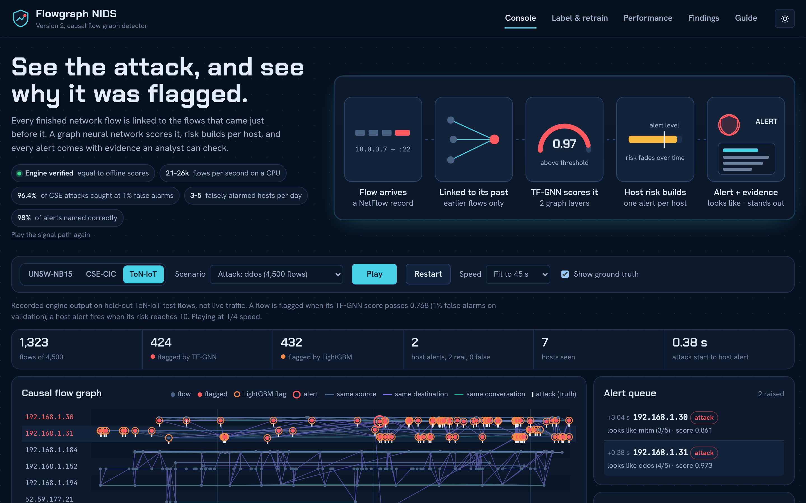
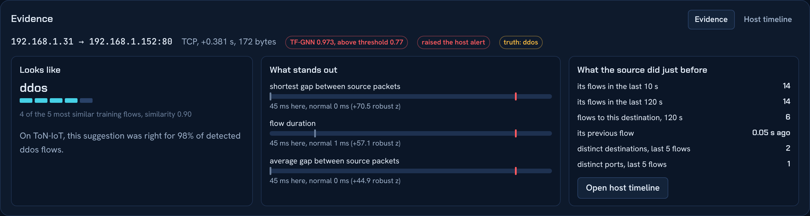
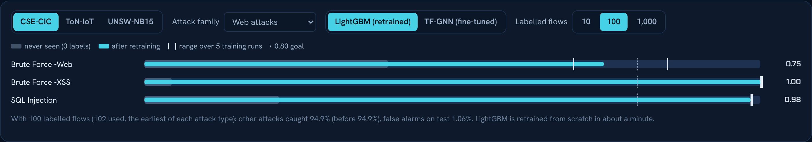

# Flowgraph NIDS

Network intrusion detection on a **causal temporal graph of NetFlow records**: every finished flow is linked to the flows that came just before it, a graph neural network scores it, risk builds per host, and **every alert comes with evidence an analyst can check**. M.Sc. Computer Science final-year project, University of Delhi, supervised by Ms. Anjali Thukral.

**Live dashboard:** https://flowgraph-nids.vercel.app/



The dashboard replays the recorded decisions of the streaming engine on held-out test flows of three public NetFlow v3 datasets. It is a replay of real NetFlow records, not live packet capture.

---

## Headline results (version 2)

All thresholds are fixed on validation data at 1% false alarms and applied unchanged to later, untouched test traffic at its real attack ratio. Every pass test below was written down **before** the run.

| | CSE-CIC-IDS2018 | ToN-IoT |
|---|---|---|
| Attacks caught, TF-GNN, mean of 5 training runs | **0.964 ± 0.0002** | **0.866 ± 0.017** |
| 95% interval (resampling whole attack bursts + seeds) | 0.82 – 1.00 | 0.58 – 0.97 |
| Alerts whose attack type the evidence card names correctly | **97.8%** | **97.9%** |
| Falsely alarmed hosts per day (median) | 5 of ~5,700 | 3 of ~60 |
| Streaming engine speed, CPU, evidence card per alert | 20,800 flows/s | 26,400 flows/s |

- **A new attack type needs only a few labels.** On CSE, 10–100 labelled flows of an attack family the model never saw bring recall from ~0 to ≥ 0.80 for 10 of 12 attack types, stable over 5 runs, with no harm to other attacks.
- **A new network needs only a few labels.** With 10–100 labelled flows, a model from another network reaches 0.81–1.00 recall on CSE and UNSW.
- **v1 was not a lucky run:** its seed-0 result sits inside the 5-run spread.



## What the system does

1. **Read** each NetFlow v3 record (53 nProbe features) in the order flows finish.
2. **Link to the past.** Connect the flow to at most 9 earlier flows within 120 s: the previous flow of the same conversation, the last 5 from the same source, and the last 3 to the same destination. Links never point to later flows, so it can run live.
3. **Describe the context.** 13 context features: how busy the hosts are, how many targets and ports the source touched, time since it was last seen.
4. **Score with TF-GNN.** A two-layer temporal flow GNN in pure PyTorch with separate weights per link type. First-layer embeddings are cached when a flow arrives, so scoring needs no graph rebuild.
5. **Second opinion.** LightGBM scores the same flow from its own features.
6. **Alert per host.** Flagged flows raise their source host's risk, which fades over time; one alert is raised when risk reaches the alert level (10).
7. **Explain the alert (v2).** The evidence card shows the 5 most similar labelled training flows in TF-GNN's own embedding (suggested attack type and vote), the measurements furthest from normal in real units, and what the source did just before.
8. **Teach it new attacks (v2).** When an analyst confirms flows of a new attack, LightGBM retrains in about a minute. Label examples spread over time, not only the first ones.

## Version 2: what was tested, in order

Each phase fixed its pass test before running. A fail is a hypothesis the data rejected, with the cause measured.

| Phase | Question | Result | What we learned |
|---|---|---|---|
| V0 | Does v1 reproduce from its frozen backup? | pass | All 48 results and every alert, largest difference 0.0001. |
| V1 | Why does v1 fail on other networks and unseen attacks? | diagnostic | Other networks are a ranking problem, not just a threshold problem; ToN-IoT false alarms drift up to 3.8× per day. |
| V2 | Can thresholds re-tune themselves without labels? | fail | Excluding alerted hosts removes the busiest normal hosts: thresholds collapse (53–82% false alarms). Fixed thresholds stay. |
| V3 | Can a graph autoencoder trained only on normal traffic catch attacks? | fail | Works on UNSW (0.95) but not CSE/ToN at 1% false alarms: rare but harmless flows outrank attacks. |
| V4 | Does judging whole hosts (60 s behaviour) work better? | fail | A few very busy normal servers look more unusual than attackers. Same lesson one level up. |
| V5 | How many labels teach a new attack or network? | fail (2 of 4) | CSE: 10–100 labels are enough. ToN-IoT needs far more; fine-tuning TF-GNN can hurt other attacks, so retrain instead. |
| V5-E | Why is ToN-IoT hard? | diagnostic | DoS changes over time; XSS and passwords need many labels; scanning is not separable in flow records. |
| V6 | How stable and how certain are the numbers? | fail (4 of 5) | CSE rock-steady; ToN varies 0.039 (limit 0.03). Intervals are wide because test sets hold few attack bursts. |
| V7 | Evidence for every alert, inside the engine | pass | Attack type named correctly 97.8% / 97.9%; engine still equals v1 exactly. |



## Known limits (measured)

- **No zero-label detection of new attack types on realistic networks.** Four label-free methods (per-flow Isolation Forest, GraphMAE, host-window models, label-free re-calibration) all fail at 1% false alarms on CSE and ToN.
- **A new network needs its own labels.** Without them, models do not transfer.
- **ToN-IoT scanning** is a blind spot of flow-feature detection (0.08 even with all its training data); **CSE Infilteration** is caught only 0.42 (0.42–0.43 over 5 runs).
- **ToN-IoT drift:** at a 1% validation threshold, test false alarms run at 1.8–2.3%.
- About half of raised alerts are false at the deployed policy (e.g. CSE 157 of 280 over 11 days); in host terms that is 3–5 hosts per day.
- The dashboard replays recorded engine output; a live deployment needs an exporter producing the same NetFlow v3 features.

## Data

| Dataset | Flows after exact de-duplication | Attack classes | P1 test flows |
|---|---|---|---|
| NF-UNSW-NB15-v3 | 2,350,609 | 9 | 348,887 |
| NF-CSE-CIC-IDS2018-v3 | 19,487,055 | 14 | 2,844,963 |
| NF-ToN-IoT-v3 | 25,704,123 | 9 | 3,625,185 |

NetFlow v3 datasets published by the University of Queensland. Features: log1p, robust scaling fitted on training data only, clipping (133 features). Source port, DNS query ID and ICMP type are dropped.

## Evaluation protocols

- **P1 (main):** each attack episode split 70/15/15 by time, with a purge gap.
- **P2:** one attack family removed from training, tested on that family.
- **P3:** train on one network, test on another.
- **P4:** one global cut in time.

## Version 1 results (P1, single run)

| Model | CSE PR-AUC | CSE recall | CSE FPR | ToN PR-AUC | ToN recall | ToN FPR |
|---|---|---|---|---|---|---|
| **TF-GNN** | **0.9833** | **0.964** | 0.93% | **0.9772** | **0.885** | **1.76%** |
| TF-GNN, no edges | 0.9781 | 0.955 | 0.90% | 0.9683 | 0.795 | 2.27% |
| LightGBM | 0.9702 | 0.949 | 1.10% | 0.9754 | 0.873 | 2.43% |
| Random Forest | 0.9691 | 0.948 | 0.99% | 0.9759 | 0.854 | 2.24% |

On UNSW-NB15 every supervised model reaches PR-AUC 1.000 (its attacks come from four attack-only hosts). Message passing adds +0.091 recall on ToN-IoT over the same network without edges.

## Repository contents

```
index.html, style.css, app.js   static dashboard (no build step)
data/replay_*.json              recorded streaming-engine output on held-out test flows
data/evidence_*.json            evidence cards from engine v2, keyed by test-file row
data/v2.json, summary.json      recorded results (v2 and v1); data/terms.json = glossary
build_data2.py                  rebuilds data/ from the Kaggle output zips (v2)
build_data.py, tools/crop.py    v1 data builder and replay-window cropping
screenshots/                    images used in this README
```

**Run locally:** `python -m http.server 8000` in the repository folder, then open `http://localhost:8000`.

**Versions:** `v1.0` (first release) and `v2.0` (this version) are git tags. Experiments run in Kaggle notebooks; frozen, checksum-verified backups of every model, score and report are kept as private Kaggle datasets.

## Main references

- Caballero Ferrero et al., *Electronics* 15, 3764 (2026). The flow-as-node temporal graph; our version is strictly past-only.
- Layeghy and Portmann, *On Generalisability of ML-based NIDS* (arXiv 2205.04112); Cantone et al., *Cross-Dataset Generalization of ML for NIDS* (arXiv 2402.10974).
- Guerra et al., *Self-Supervised Learning of Graph Representations for Network Intrusion Detection* (GraphIDS), NeurIPS 2025.
- Hou et al., *GraphMAE: Self-Supervised Masked Graph Autoencoders*, KDD 2022.
- Sommer and Paxson, *Outside the Closed World: On Using Machine Learning for Network Intrusion Detection*, IEEE S&P 2010.
- Wang et al., *Are We There Yet? Unraveling the State-of-the-Art Graph Network Intrusion Detection Systems* (arXiv 2503.20281).
